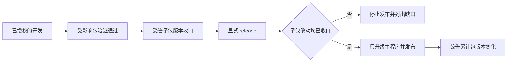

# 子包开发版本与主程序发布

> 2026-10-24：开发入口、自动稳定和发布分工已完成实现、工程验证及用户验收，已获发布授权。实际验证结果与剩余边界见[需求卡](../../1_delivery/package-version-lifecycle/requirements_2026-10-24_package-version-lifecycle.md)，不能用设计说明代替通过证据。

> 2026-10-28：当前候选按 [TODO-044](../../1_delivery/forge-simplification/requirements_2026-10-27_workflow-and-versioning.md) 将版本覆盖与长期环境/测试认证解耦。实现及验证进度以需求卡为准；工厂方案 A、正式版本与历史验收保持原状，本候选不等于用户级安装已更新。

## 职责与事实源

公共红线在 `templates/AGENTS.md`；版本判级、稳定条件和证据规则只维护在[版本生命周期合同](../../../templates/skills/git-sync/references/schema4.md)。develop 和 git-sync 分别编排开发收口与正式发布，本文件解释设计原因，不重复维护规则表。

普通 git-sync 可独立保存已有改动，不要求先完成开发收口，也不自动调用 release。图中“只升级主程序”包含主程序的原生版本载体；独立包版本不再次改变。

## 两个基线

开发收口比较每个包上次有效收口后的实际变化；正式发布比较上次产品发布以来的累计变化。两者不能共用一个不断前移的基线。

假设某包在两次 develop 中由 `0.3.0 → 0.3.1 → 0.4.0`，release 公告累计 `0.3.0 → 0.4.0`，不再次升子包。追加历史仍保存在 `.codex/package-closures.json`，保留版本理由、真实检查与接受依据；不把聊天中的 passed 当作执行证据。

长期版本覆盖只跟踪源码、实际依赖与构建输入。换机器、会话或调整测试策略本身不重新打开已有版本记录。环境和检查合同继续约束当前任务的执行计划、真实检查和回滚；这避免把版本连续性做成长期测试证书，同时保留短期防漂移。

普通开发按本次风险选择非空已登记检查，保留命令边界和项目明确必需项。自动转为 1.0.0 仍执行完整 core/integration 稳定清单；失败时回到开发候选并重新验证最终依赖图。检查针对最终候选版本，不复用升版前产物冒充最终交付。

release 先判断累计业务发布需求，再检查实际范围的版本覆盖与声明交付物。它不组织业务回归、不补做 develop，也不因旧机器环境摘要变化而要求全部重验。项目显式必要发布检查仍按当前环境、输入和产物验证；环境变化后的旧检查不能直接重新绑定。

Git 证明等价的 LF/CRLF 使用相同内容身份，原始字节和有效规范化规则仍用于事务防漂移。共享 Cargo.lock 按实际依赖闭包比较；显式全局构建输入包含忽略文件、缺失状态、目录成员及空目录，继续完整核验。旧历史保留原字节/哈希链，不能证明的聚合记录通过实际检查追加覆盖，不把算法变化当作业务升版原因。

## 新旧衔接

原 release 同时写主程序和子包的算法已拆分：开发入口复用原生适配器处理子包、依赖和锁，发布入口读取已收口版本。身份生命周期与版本连续性分别核验，避免旧“只有正式发布能改包版本”的检查误拒绝合法开发收口。

既有正式发布版本和历史保持不变。接入复用 schema 4 的配置提案 plan/apply，补充项目 `development` 检查合同，保留发布基线。未发布改动不由迁移认证，须完成适用的开发验证和收口。新的能力标识、CLI 和字段只在版本生命周期合同维护。

旧 `development-checks.json` / `prepared` 继续作为可选发布候选准备，不代替子包收口，也不重新引入全量回归或用户验收前置。新门槛仅用于 release 的受影响子包，不影响普通 Git 保存。

## 本轮传播与验证边界

- 通用产品层：Rust 实现、共享 develop/git-sync Skills 及受管投影同步；AGENTS 和 Hook 默认保留，具体调整另行确认。
- 工厂专属：按开发收口清单选择验证，不向模板传播工厂测试或构建要求。
- 文档引起的派生清单通过受管 manifest 入口刷新，不手写 hash；业务 VERSION 和正式 CHANGELOG 不在本轮更新。
- 保留既有工作区改动和历史验收事实；旧接入合同只补历史适用边界与新合同导航。
- 实现使用隔离 Git 夹具验证，不修改真实下游；源码、构建、夹具、独立审计的实际结果分别记入需求卡，真实下游与自然 runtime 单列未验证。
