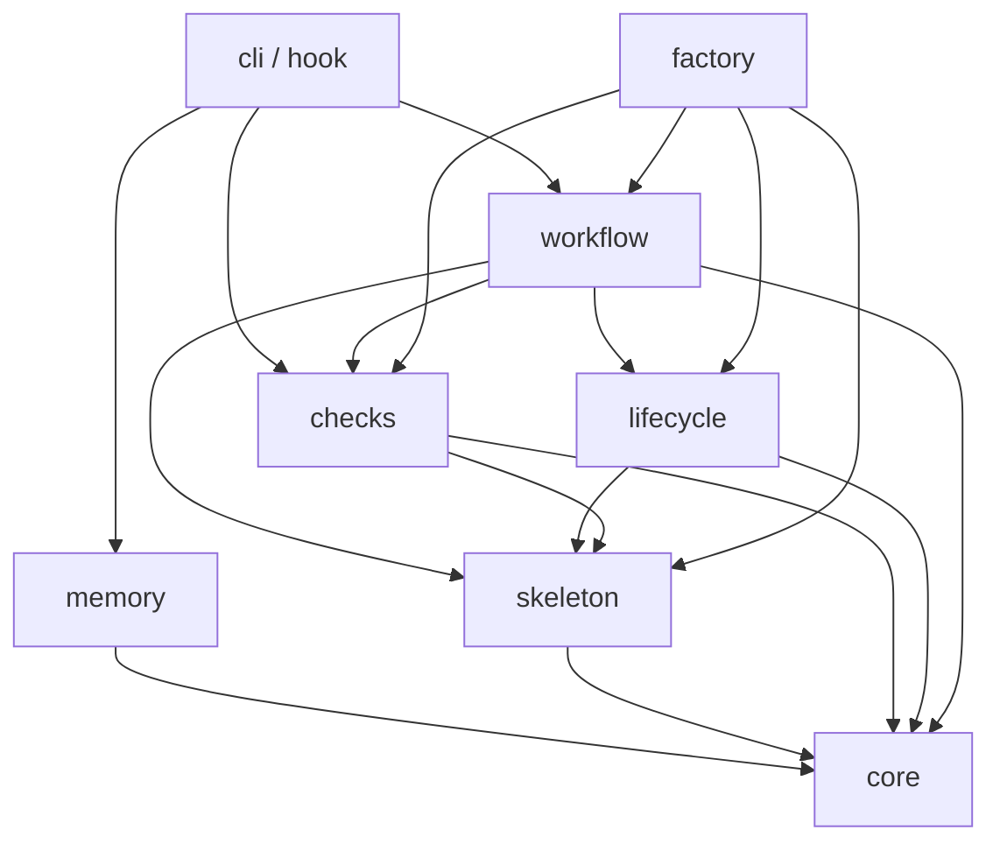

# Rust 源码、公共投影与工厂工具

Rust 唯一维护源位于根 workspace 的 `source/`。目录使用简短职责名，Cargo 原生包名仍为 `bridgeforge-*`。`.codex/hooks/` 是由受管生成器产生的公共运行时投影，不作为第二份维护源。

| 目录 | 职责 | 主要边界 |
|---|---|---|
| `source/core` | 进程、文件与锁、JSON、持久化、构建输入/缓存/收据、公共源码投影、基础版本类型 | 不作同步、发布或 Memory 业务决策 |
| `source/skeleton` | 骨架合同与基线核验、内容合并、项目 Hook 注册和隔离构建 | 负责骨架语义，不编排 Git 发布 |
| `source/lifecycle` | 原生包发现、版本/依赖图、历史与身份连续性、开发收口和主程序发布计划 | 接收进程接口与派生候选生成器，不依赖工厂实现 |
| `source/workflow` | Git 同步、项目同步、公共产物准备、项目 Hook 迁移与执行事务 | 编排公共能力；工厂事务通过类型化接口注入 |
| `source/memory` | Codex 原生 Memory 同步、远端、冲突、所有权、恢复与后台工作 | 不解析或改写官方 Memory 正文 |
| `source/checks` | 文档、Skill、TODO、产物布局、指令来源与编码规则 | 返回结构化报告，不拥有 Hook 事件或 CLI 输出流程 |
| `source/factory` | 工厂 manifest、dogfood、批量控制、工厂运行时及工厂 Git 写入计划 | 仅工厂分发和维护使用；公共包不得依赖它 |
| `source/cli` | 公共 `bridgeforge` 命令解析与输出适配 | 主程序版本载体；规则调用对应能力包 |
| `source/hook` | Hook 事件、输入筛选、会话状态、检查结果与退出码适配 | 主程序版本载体；Windows 无控制台入口 |

根 `Cargo.toml` 显式登记九个成员；`workspace.metadata.bridgeforge.public-members` 显式选出八个公共成员。公共生成器输出独立的 Cargo manifest、依赖闭包锁文件及 `.codex/hooks/source/<目录>/`。factory 源码与二进制不进入公共骨架合同。公共源码投影必须可在没有工厂测试和 factory 包的目录内锁定构建。

通用 Skill 唯一维护源为 `templates/skills/`；分发清单保留各 Skill 的显式 source、安装 target 和 hash。用户级安装目标仍为 `~/.codex/skills/`，本仓库只镜像已登记的自身 Skill，不把全部 Skill 安装到每个下游。

根 `VERSION` 管主程序，CLI/Hook 跟随该版本；其余七包登记独立身份和原生版本。开发收口先生成版本、依赖和锁候选，再由 factory 的纯 materializer 生成公共源码、dogfood、分发合同及测试消费锁，统一交给开发事务写入和恢复。release 只更新主程序载体，读取既有子包收口。详细判级与证据见[版本生命周期合同](../../../templates/skills/git-sync/references/schema4.md)。

工厂准备从根 workspace 当前源码启动 `bridgeforge-factory`，准备公共 CLI、无控制台 Hook 和私有工厂工具；源码、锁、配方、环境、二进制与收据共同决定复用。公开 CLI 的工厂兼容入口只调用身份核验通过的本地工厂工具。安装与恢复入口为 [INSTALL.md](../../../INSTALL.md)。

本轮实施与验证状态见 [TODO-032 需求卡](../../1_delivery/source-workspace-refactor/requirements_2026-10-24_source-workspace.md)。九包源码、公共投影、dogfood 与独立版本已落地，实际验证以需求卡和受管收据为准；真实下游、正式用户级安装与自然生命周期验证不在本轮范围内。
