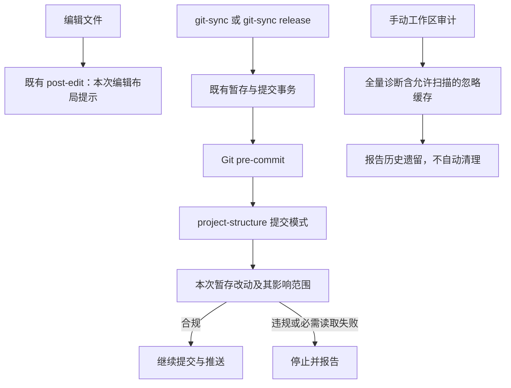

# artifact-layout Hook 吸收进 Forge 的合并计划

关联原需求：TODO-020。本卡保留合并计划及授权历史；本地实施与工程验证已完成，用户已于 2026-10-23 明确验收并授权 release，见第 14 节；工程证据见第 13 节。

## 1. 目标、决定与授权

将 StratusAgent 的 artifact-layout 中可复用的布局检查提炼到 Forge，复用 project-structure、现有 post-edit 和 pre-commit，不另建一套提交或发布流程。

用户本轮原始要求：

1. 明确通用规则、项目配置、涉及文件和验证方式。
2. 核对与 git-sync 重复的工作并确认工作流。
3. 直接抛弃 stratus/apps/m2_benchmark 等历史专用硬编码。
4. 先不要修改代码。

后续补充要求：artifact-layout Hook 合并不得引起 git-sync 及 release 性能下降；必要时使用 refactor-scan。该要求作为实施验收硬条件，不代表本轮已授权运行扫描或重构代码。

用户随后明确“可以，选A”，确认提交时只检查本次暂存改动及其影响范围；本次不涉及的历史违规另行专项检查、清理。最后要求“生成 artifact-layout hook 合并计划”，本轮据此获准写计划、文档索引及关联 TODO，不推定为实施授权。

| 项目 | 当前授权与状态 |
|---|---|
| 方案与工作流 | 已确认采用 A；沿用本卡 |
| 文档记录 | 已授权并持续更新同一需求包 |
| 产品代码与 dogfood 修改 | 后续明确批准 autopilot 后已授权，实施中；见第 9 节 |
| 构建、完整回归和独立审计 | 已纳入启动授权；实际结果分别记录 |
| 真实下游接入、历史文件清理 | 未授权；不得修改 StratusAgent 正式工作区 |
| commit、push、release、安装分发 | 未授权 |

不做：自动搬文件或删除缓存；历史债务清理；源码 include/path 反向引用分析；Cargo 依赖方向、自动 target 发现及 DLL 身份审计；version-sync、target-cleanup 或 git-sync Git 事务重写。

## 2. 现状证据与传播判断

以下是本会话只读核验得到的实现事实，不是新实现已通过验证：

| 位置 | 已核实事实 |
|---|---|
| StratusAgent/.codex/hooks/project_stratus_runtime/artifact_layout.rs | 检查 Python 缓存、独立测试路径、stratus 禁止目录、Cargo 显式外部注册；提交模式读取暂存 blob，其他模式只警告；部分遍历错误被跳过 |
| StratusAgent/.githooks/pre-commit | 公共区先调用 Forge project-structure，项目扩展再调用 artifact-layout；根测试目录检查重复 |
| StratusAgent/.codex/hooks.json | 本会话所查注册未直接启用 artifact-layout 的 SessionStart 或编辑检查；不能把模式支持等同于已自动运行 |
| templates/hooks/crates/bridgeforge-core/src/project_structure.rs | 已禁止根 test/、tests/，并检查文档层级、生命周期、索引、TODO 和活动文档引用 |
| templates/.githooks/pre-commit | 已调用 project-structure，同时保留 baseline、编码、Skill 元数据等其他保护 |
| templates/hooks/crates/bridgeforge-core/src/git_sync.rs | 暂存后执行 git commit，由 Git 调用 pre-commit；同时维护 baseline、索引/提交 tree 和推送保护 |
| templates/hooks/src/lib.rs | post-edit 已归一化编辑结果并顺序调用检查；SessionStart 有现成分发入口 |
| templates/hooks/crates/bridgeforge-core/src/release_preparation.rs | 记录文档的轻量核验会调用 project_structure::inspect；合并时必须避免让该路径隐式扩大为产物全仓审计 |

源项目是只读参考，不是本轮改动目标；源码、配置可能继续变化，实施前只复核本卡依赖的差异，不沿用旧 runtime 结论。

| 传播四问 | 结论 |
|---|---|
| 产品层、自身配置还是元文档 | 通用检查器、合同及入口属于产品层；本仓库配置属于自身配置；本卡属于元文档 |
| 通用还是工厂专属 | 通用机制进入 templates；StratusAgent 的目录值只放项目配置，工厂专属事实不下沉 |
| 版本与 CHANGELOG | 后续发布需要产品版本及 [product] 记录；只由明确授权的 git-sync release 生成，本轮不预写 |
| 是否同步 dogfood | 后续实施必须同步 .codex/hooks 与 .githooks；工厂只通过 dogfood 硬闸，不执行下游 project-sync adopt/apply |

## 3. 通用规则、项目配置与丢弃项

| 内容 | Forge 提供的能力或公共规则 | 项目提供的事实 |
|---|---|---|
| 根测试目录 | 统一既有根 test/、tests/ 禁令，只报告一次 | 无须重复声明 |
| 独立测试位置 | 目录边界判断；test_*、*_test 文件名只能辅助提示，不能单独作通用阻断条件 | 测试根，沿用 scripts/tests/ |
| Python/pytest/coverage 缓存 | 识别 __pycache__、.pytest_cache、htmlcov、.coverage 及分片、coverage.xml、pyc/pyo，按项目启用 | 允许的根缓存目录；不全局强推 .runtime/ |
| 生产目录夹带测试或工具 | 检查明确配置的禁止目录组件 | 生产源码根及禁止组件 |
| Cargo 外部注册 | 解析 workspace.members，以及显式 test/bench/example/bin.path；解析相对 manifest 的目标位置 | 需要检查的生产 manifest 根、禁止注册的目标目录 |
| 输出与错误 | 统一规则编号、路径、原因、建议位置与检查完整性 | 不配置任意脚本或可执行表达式 |

公共能力不禁止正常生产库依赖，不把 Rust 源码内 cfg(test) 单元测试判成独立测试违规。本期不承诺完整 Cargo/源码架构分析。

直接丢弃 m2_benchmark 专用路径分支、旧 stratus/trader 自测样例、旧 .claude 整体豁免，以及其他依赖具体旧项目/模块名的判断；不建立历史黑名单配置。Forge 受管测试资产按明确资产身份识别，项目自有 Hook 测试按项目合同声明，不用整个 .codex 目录免检；此例外不自动豁免缓存位置检查。

### 拟新增项目配置

建议以项目所有的 `.codex/artifact-layout.json` 为唯一机器事实源，schema 为 1。下面是拟议字段和 StratusAgent 示例，尚非已实现接口，不在本轮写入下游：

```json
{
  "schema": 1,
  "source_roots": ["stratus/"],
  "tests_root": "scripts/tests/",
  "tools_root": "scripts/",
  "python_artifacts": {
    "enabled": true,
    "allowed_roots": [".runtime/"]
  },
  "forbidden_source_components": [
    ".runtime", "tests", "scripts", "bench", "benches", "examples"
  ],
  "cargo_registration": {
    "manifest_roots": ["stratus/"],
    "forbidden_target_roots": ["scripts/"]
  }
}
```

配置行为：无文件时仅运行已有公共规则，不自动创建或推断项目值；有文件时严格校验版本、字段、路径和冲突，非法配置不得静默降级为未启用。允许 tests_root 位于 tools_root 下，不能把这个合法包含关系判成冲突。路径以仓库根为基准，拒绝绝对路径和越界；目录判断必须按组件边界，避免 scripts 与 scripts-other 混淆。

产品拥有检查实现和配置合同；项目拥有配置正文。project-sync 升级不得覆盖、重置或删除它；配置示例以合同文档承载，不新增第二份持续维护的机器规则。新增产品文件用稳定 asset id、显式 source/target 与历史 hash 登记，不使用 glob ownership。

## 4. 已确认的 A 工作流

### 提交与审计的分工



1. 新增、修改、移动到违规位置的文件阻止提交。纯删除违规文件应允许通过；重命名检查最终目标位置。
2. 本次未涉及的历史违规、未暂存文件和被忽略的散落缓存，不阻止本次提交。提交通过不代表整个项目布局合规。
3. 修改或删除布局配置时，同时比较 HEAD 与暂存版本；对规则变化影响的已有暂存树内容扩大检查。删除配置不能被当作一次无关文件删除而漏掉影响分析；明确停用的规则按变更后的有效合同处理。
4. 修改 Cargo manifest 时读取其暂存 blob；目录/文件变化影响已有注册目标时，纳入相关 manifest。被纳入检查的 manifest 只报告与本次变化相关的违规，不能重新阻断无关历史问题。
5. 提交使用暂存版本的规则、路径及 Cargo 内容，不能用工作区已修好的内容替代未修好的暂存内容。没有配置时执行有效公共默认规则。
6. 根 test/tests 的既有规则也纳入统一 A 口径，不能仍由旧工作区存在性判断拦住无关提交。现有文档、TODO 和索引检查维持原有职责，不顺带改成全部仅查暂存区。
7. 手动工作区审计用于发现历史遗留，明确列出排除范围、读取失败和未检查项；不将不完整扫描报告成通过。不跟随链接越界，不遍历 .git、依赖环境或构建大目录；先检查目录自身是否违规，再按边界停止深入。
8. 默认不开启 SessionStart 全仓扫描。post-edit 复用现有归一化路径，只提示本次编辑；shell 生成、漏掉的编辑事件仍由提交检查兜住，不声明覆盖所有写文件行为。

拟议 CLI：保留 `check project-structure --root .` 为人工工作区审计入口，新增明确的 `--pre-commit` 模式供提交调用；参数需在实现时正式登记。内部拆开原有文档检查与布局检查，避免 release preparation 的记录文档轻量核验隐式触发全仓缓存扫描。

### 与 git-sync 的去重和保留

| 工作 | 结论与安排 |
|---|---|
| 两个检查器都禁止根测试目录 | 合并规则、删除重复调用；同一问题只报告一次 |
| git-sync 外层再主动跑布局命令 | 不新增；只由其 git commit 触发 pre-commit |
| 现有 baseline、编码、Skill 检查 | 职责不同，保留；不借本任务删除其他保护 |
| 暂存读取 | 复用项目既有 Git 调用/暂存读取能力；布局模块不执行 add、commit 或修复 |
| Git 索引/tree 漂移与推送保护 | 保留既有事务，不另造 receipt、缓存或绕过开关 |
| 版本/lock/CHANGELOG 与受管产物构建 | 仍归发布和构建流程；布局检查不负责版本同步 |
| 开发阶段完整审计 | 可单独执行，但不能成为普通同步必须已有验收收据的条件 |

### git-sync 与 release 性能不退化硬条件

合并后，普通 git-sync 和 git-sync release 都不得因布局检查出现可重复、可归因的性能下降。不能以“新增检查必然有开销”为由默认接受变慢，也不能只凭删掉一个 Hook 进程就宣称性能通过。若无法在测量精度内区分变化，只能报告“本场景未检出退化”，不能声称所有真实场景零开销。

1. **先建基线再实现。** 固定同机环境、Rust release 构建模式、Git/配置、仓库规模、差异内容和本地 bare remote。用相同 fixture 起点分别跑合并前后版本，避免第一次已提交后第二次变成 clean 的错误对照。每个场景至少 5 次有效样本，前后交错运行；记录全部样本、中位数及波动范围，不挑最快值。
2. **分别覆盖关键路径。** 无新变更的同步、有变更的普通同步、实际执行升版的 release、只读 release preview，以及文档变更轻量路径均做对照；布局配置缺失/启用、少量/批量文件变化、配置变更引起的扩大检查分别覆盖。扩大检查在合并前没有完全相同功能时，额外对照合并前的完整同步/发布成本，并单列新增检查耗时，不能隐去新增场景的代价。
3. **分开报告用户总耗时与内部耗时。** 记录用户指令到最终回复的端到端时间，以及现有 sync_elapsed_ms、timings_ms 中 commit_and_hooks、发布分析、必要构建等阶段；父子阶段不相加。离线 CLI/fixture 的计时仅证明其覆盖范围，不能冒充真实对话端到端结果。真实远端或自然对话未授权实测时明确列为未验证，不为性能采样擅自提交或发布。
4. **控制构建与缓存变量。** 稳态复用和首次必要构建分别比较，构建数量、缓存命中、构建输入身份须有记录。不能用合并后的热缓存对比合并前的冷构建，也不能在总耗时中偷偷扣掉合并引起的重建。无相关输入变化时，不得新增受管构建或使原有发布准备/检查缓存无故失效；需要读取新配置的检查必须正确绑定配置输入，不能为提速复用失效结果。
5. **限制热路径工作量。** 提交时只处理 A 范围；不遍历全工作区、忽略缓存或构建目录，不在 git-sync 外层、release preview、发布分析、记录文档轻量核验重复扫描。批量读取必要暂存 blob，复用解析和本次调用内的已验证输入，避免逐文件启动 Git 子进程。配置变化的扩大检查必须按实际影响范围执行，不允许为快而漏检。
6. **按数据判定。** 每个场景分别判断，不用某条路径提速抵消另一条退化。前后波动范围重叠、样本不足或有环境干扰时结论为未确认，补充定向复测；确认可归因的退化即不通过。不自动接受任意百分比或固定毫秒的宽限；若确需性能容差，必须另有明确用户决定。

必要时使用 refactor-scan 的触发条件：基线已显示重复读取/解析/进程启动占据可观时间；设计检查发现合并将增加重复扫描或破坏快路径；或者前后对照测得退化。扫描限于 artifact-layout、project-structure、pre-commit、git-sync/release 直接调用链及复用边界，给出有调用位置和耗时证据的编号候选，不扩展成全仓重构。

refactor-scan 只负责取证和建议；不能替代本卡性能验收，也不能作为自动重写 Git/发布事务的授权。实施已有授权范围内的去重、批量读取等方案时复用该授权；候选若改变接口、安全保护、事务语义或扩大模块范围，另行确认。扫描和必要修复、复测成本计入同一实施预算；超预算按停止点处理。没有适用基准或可靠数据时，标记性能未验证，不以静态扫描结论宣称通过。

## 5. 影响文件

以下均相对本仓库；新增路径是实施提案，不代表文件已存在。

| 文件 | 修改目的 |
|---|---|
| templates/hooks/crates/bridgeforge-core/src/artifact_layout.rs（新增） | 配置解析、路径/Cargo 规则、工作区和暂存影响范围、完整性报告 |
| templates/hooks/crates/bridgeforge-core/src/project_structure.rs | 统一报告与根测试规则，拆分文档检查和布局检查，增加调用模式 |
| templates/hooks/crates/bridgeforge-core/src/lib.rs | 登记模块 |
| templates/hooks/crates/bridgeforge-cli/src/main.rs | 登记提交模式及结构化错误输出 |
| templates/hooks/src/lib.rs、src/post.rs | 在既有 post-edit 链接入提示，复用 Edit/Write/MultiEdit/apply_patch 归一化结果 |
| templates/.githooks/pre-commit | 原调用位置切换统一提交模式，不叠加第二次布局扫描 |
| templates/hooks/crates/bridgeforge-core/src/release_preparation.rs | 如需适配，显式调用文档检查，保留记录文档轻量复用边界 |
| templates/managed-skeleton.json | 登记新增受管产品源、目标及派生 hash；不接管项目配置正文 |
| .codex/hooks/**、.githooks/pre-commit | 对应 dogfood 镜像；不手工改 .bridgeforge_codex_version |
| scripts/tests/unit/core_artifact_layout.rs（新增）及实际测试注册处 | 单测和输入边界 |
| scripts/tests/src/distribution_regressions.rs、git_sync_runtime.rs、unit/core_git_sync.rs | 结构兼容、升级保留与 Git 工作流集成 |
| doc/0_architecture/design/artifact-layout.md（实施时新增） | 最终配置合同、规则范围和使用入口；本卡保留选择与验收事实 |
| doc/README.md | 登记计划及后续架构文档 |
| skills/git-sync/SKILL.md 与 .codex/skills 对应镜像（仅必要时） | 只补布局检查归 pre-commit 的说明，不增加执行步骤 |

git_sync.rs 预计不增加布局扫描。templates/hooks.json 预计无需新增独立 Hook 注册，SessionStart 不加扫描；若既有 post-edit 足够承载，则直接复用。

StratusAgent 的配置、旧调用删除与旧实现退役属于后续接入动作：先在获准测试 worktree 对照验证，再按明确授权切换，不在本次 Forge 实施中擅改正式项目。

## 6. 实施顺序和验收标准

| 顺序 | 优先级与明确动作 | 完成断言 |
|---|---|---|
| 0 | P0：建立 git-sync/release 性能基线并检查调用链 | 保存可复现起点、样本及阶段耗时；发现重复工作或潜在退化时先做限定范围 refactor-scan |
| 1 | P0：固定 A 模式输入、配置合同和报告模型 | 有配置/无配置及错误语义明确；按本次影响范围判断，不引入历史基线快照 |
| 2 | P0：实现通用规则与 Cargo 显式注册检查 | 去掉项目专名；合法目录通过，明确违规被定位；路径越界和必需读取失败不放行 |
| 3 | P0：接入统一 pre-commit 与编辑提示 | 暂存/工作区不同时以暂存为准；根测试目录不重复报告；检查零写入 |
| 4 | P0：验证 A 模式、Git 事务兼容及性能不退化 | 隔离仓库、本地 bare remote；违规停止提交/推送，修复可同步，普通同步不升版；与步骤 0 同场景对照，git-sync/release 可归因退化不得通过 |
| 5 | P1：同步产品分发与 dogfood | 显式资产登记、模板/镜像一致、配置升级保留、不新增运行时 Python 依赖 |
| 6 | P1：完成工厂检查与独立审计 | 使用 development-checks.json 和开发收口清单；完整 fixture/workspace 及独立结论有实际证据 |
| 7 | P2：完成单独授权的下游样本接入 | 测试 worktree 的旧/新行为对照通过后才移除旧布局调用，正式下游与 runtime 单列证据 |

### 必测场景

| 场景 | 预期 |
|---|---|
| 根 test/tests、生产禁止目录、本次改动的独立测试位置 | 违规阻断；合法 scripts/tests 放行；删除违规文件放行 |
| 未涉及的历史错误、忽略缓存、未暂存违规 | 不阻断 A 模式；人工审计可报告实际扫描范围内的问题 |
| 工作区 Cargo/配置已修复，暂存仍违规 | 提交阻断；反向差异也只按暂存判断 |
| 配置新增、变更、删除，目录重命名 | 受影响已有路径与相关 Cargo 注册纳入判断，无关历史问题不阻断 |
| Cargo workspace member 和显式 test/bench/example/bin path | 按配置边界判断；无效 TOML 和必需 blob 读取失败阻断；正常生产依赖不受影响 |
| Windows 大小写、反斜杠、..、目录前缀相似、链接 | 组件边界和平台语义正确，不能越界或读到仓库外 |
| 受管 Hook 测试、项目测试、普通 cfg(test) | 按真实归属判断，不恢复 .claude/.codex 整体豁免，不误杀内联单元测试 |
| post-edit 和 apply_patch 多文件输入 | 覆盖归一化后的本次编辑；只提示，不回滚、不自动修复 |
| project-sync 更新、检查和预览 | 配置正文保留；check/dry-run 和布局检查零写入 |
| git-sync 普通同步及 release | pre-commit 只运行一次布局检查；不新增全量验收前置；原 Git/版本保护有效 |
| git-sync/release 合并前后性能 | 相同 fixture、构建与缓存条件，至少 5 次样本；逐场景记录中位数、波动和阶段耗时；可归因退化不通过，真实端到端缺口单列 |
| release preview、无变更同步及缓存复用 | 不新增重复布局扫描、无关构建或缓存失效；输入变化仍正确使依赖检查失效 |
| 记录文档轻量核验 | 不触发全仓缓存扫描，不因无关本机缓存失去既有轻量语义 |
| SessionStart | 默认没有新增全仓扫描 |

后续实施使用受管入口并锁定 Cargo.lock，按开发收口清单执行 manifest --check、结构检查、mirror drift、完整 workspace、完整工厂 fixture 和独立 review-auditor 审计。隔离 Git 测试只向本地 bare remote 推送，不触碰真实远端；工程检查通过不能代替自然 Hook runtime 或真实下游验收。

## 7. 规模、预算、风险与停止点

产品实施暂定 L 级：新增通用配置合同，涉及暂存版本、影响范围、提交入口与产品传播。机械镜像文件不单独抬高规模。

初始规划阶段仅生成计划和文档登记。随后用户已批准第 9 节 autopilot 启动约定，实施与预算以该节最新明确决定为准；token 未实测，不创建 Memory 或额外执行协议。

风险重点：A 模式影响范围过窄会漏检，过宽会重新阻断历史问题；整个 inspect 调用扩展可能损坏记录文档轻量路径；配置所有权错误可能导致升级覆盖；文件名猜测或目录整体豁免可能误报/漏报；逐文件 Git 进程、重复解析、扩大扫描及构建/缓存身份变化可能拖慢同步或发布。

出现以下情况停止受影响动作并报告：需要加入本期排除的源码/自动 target 分析；需要改变生产接口或 DLL 边界；需要写真实下游或安装分发；配置不能在升级中保留；需要放宽既有 Git/安全保护；锁文件无关漂移；预计超出已批准实施预算。同一问题两次实质修复失败后按项目 escalate/debate 约束处理，不盲修。

git-sync 或 release 测得可归因退化时，停止以“工程完成”交付；先定位并按上述条件进入 refactor-scan/定向修复。缺少可复现基线或有效复测时，性能验收保持未验证；不得通过降低布局检查覆盖或绕过 Git 保护收口。

## 8. 实施与验证记录

2026-10-23：已确认 A 工作流和丢弃历史硬编码；本轮生成计划并登记 TODO-020。源码、产品传播、dogfood、fixture、真实下游和自然 runtime 均尚未验证新能力；文档自身的轻量检查结果另行记录。本轮不构建、不完整回归、不提交推送发布。

文档轻量核验：`.codex/bin/bridgeforge.exe check todo --root .` 与 `check project-structure --root .` 均退出 0、errors=[]；后者只有既有事项归档建议，本轮未处理。`git diff --check` 通过。当前改动仅为本卡、doc/README.md 和 TODO 总表；TODO-020 为待执行，lifecycle=active、validation_status=not_started 表示产品实施和验证未开始，不与文档检查通过混淆。

2026-10-23 补充计划：按用户要求加入 git-sync/release 性能不退化硬条件、合并前后基线与复测方法、热路径约束，以及必要时的 refactor-scan 触发条件与授权边界。本次仅补文档，未执行性能基准、扫描、代码重构、真实 Git 同步或 release；性能结果仍未验证。

## 9. autopilot 启动约定（已批准）

用户先要求“先给我完整实施的时间、token 和验证预算，确认后再开工”，随后要求“准备进入 autopilot”。截至本段记录，尚未明确批准实施预算或启动 Goal。本段是同一 TODO-020 的启动准备，不新建第二份需求正文、不将准备调用当作开工授权。

启动更新：用户明确“确认，按上述约定启动 autopilot，接受 1.8% 作为临时额度参考。先解决 baseline 权限卡点，通过后按计划实施；不要提交、推送、发布或修改真实下游”。原生 Goal 已创建，tokenBudget=120000。相同 `.codex/bin/bridgeforge.exe check baseline --root .` 在获准正常权限环境退出 0、state=clean，原卡点已解决；未绕过检查。开始实现与验证，沿用上述启动约定，产品实施状态为 in_progress。

### 任务包与依赖

| 编号 | 来源与目标 | 依赖及文件边界 | 验收与当前状态 |
|---|---|---|---|
| 020-0 | 本卡 §4、§6：恢复 baseline 核验并建立性能基线 | 首项；既有受管检查及隔离性能 fixture，不修改真实 Git 元数据 | 已完成；baseline、原始旧二进制和两轮性能对照及补测有收据 |
| 020-1 | 本卡 §3：通用规则与项目配置合同 | 020-0 通过；core/artifact_layout、project_structure、模块登记 | 已完成；定向及完整 workspace 通过 |
| 020-2 | 本卡 §4：统一 CLI、编辑提示和 pre-commit | 020-1；CLI/Hook 及模板 pre-commit，保留 Git/发布保护 | 已完成；Hook 提示、隔离 CLI 工作流及完整 fixture 通过 |
| 020-3 | 本卡 §5：传播与 dogfood | 020-1、020-2；明确登记的模板资产、镜像及配置合同文档 | 已完成；manifest、全树镜像、受管构建和配置保留验证通过 |
| 020-4 | 本卡 §6：功能、性能和工厂验证 | 020-1～020-3；scripts/tests 与隔离本地 bare remote | 已完成本批工程验证；性能结论及未覆盖边界见 §12、§13 |
| 020-5 | 本卡 §6、§7：独立审计与交付 | 020-4；review-auditor 只读复核，主对话整合和记录 | 静态审计和七项工程检查通过，prepared 已生成；用户已明确验收，见 §14 |

第 6 节的真实下游样本接入仍单独授权，不属于本批。历史清理、正式仓库提交/推送/release、用户级安装和外部业务数据写入均排除。本地隔离测试仓库中的模拟提交、升版与本地 bare remote 推送属于功能验证，不是正式仓库的 Git 发布授权。

### 拟议整体预算与委派

- L 级；整包预计约 10 小时。按 autopilot 口径只作时间预估，不设时间硬上限；此提案经批准后取代前轮普通 develop 的“10 小时累计上限”提案。
- 整体估算预算 120,000 新增 token，含本次任务包准备、主对话、必要限定范围 refactor-scan、一名独立审计、实现、整合、验证、合理返工和收尾余量；token 未实测，不按阶段或 Skill 追加预算。
- 周额度 1.8% 仅是沿用历史 provisional 系数 0.152 个百分点/万 token 的条件估算。来源为 project-sync-performance/requirements_2026-10-20_build-reuse.md 中既有预算记录；当前模型/速度适配未核实，等待用户接受临时参考，不把账户窗口百分比当成本任务消耗或系数校准。
- 主对话负责所有实施与集成；最多 1 名既有角色 review-auditor 做只读独立审计及必要复核，继承当前 model/effort，不额外启动实施 Agent。预算包含该审计工作。
- 最多 2 轮完整验收闭环：首次完整验收与必要修复后的复测；每轮包含本卡既定功能、工厂和性能验收。性能每个场景前后各至少 5 次有效样本。代码未变的权限/工具重试不另计验证轮次，但计入实际成本，不无限重跑。
- 原生 Goal 尚无，待明确批准后创建单个匹配目标。Goal 用量归集是否覆盖子 Agent 尚未实测；不得把主线程读数冒充整包精确统计。启动前复核该覆盖缺口，预算观察使用可得原生统计和委派/验证代理闸，预留收尾。统计从正式 Goal 启动开始，不回填此前准备 token 为已实测；原生阈值不是逐 token 精确截断，可能有在途超额。

### 启动预检收据

| 项目 | 结果 | 证据与边界 |
|---|---|---|
| 当前项目与分支 | 已只读核验 | D:/Quant/BridgeForge，main；当前差异仅为本计划目录、doc/README.md 和 TODO 总表 |
| 当前 Goal | 已实测为空 | get_goal 返回 goal=null；未创建实验或正式 Goal |
| 本对话 Agent | 已实测仅主对话 | list_agents 只列 /root；未启动子 Agent；不能据此证明外部编辑器绝无写入 |
| 工具链 | 版本命令通过 | rustc/cargo 1.94.1，manifest 要求 rust-version=1.88；锁文件存在，尚未做锁定构建 |
| CLI | 自检通过 | bridgeforge self-test --json 返回 status=ok、version=3.0.1 及 git-sync 相关能力；不等于所有命令通过 |
| baseline | 权限受阻，未通过 | check baseline --root . 在初始化临时 attribute sandbox 的 .git/config 时 Permission denied；未认定为源码缺陷，未变更 ACL、关闭保护或尝试替代检查 |
| Hook 与验证入口 | 仅静态核验 | hooks.json、CLI/Hook 构建收据存在，core.hooksPath=.githooks；development-checks.json 七项检查存在。自然 Hook 触发、产物身份和完整测试未验证 |
| 磁盘 | 已只读核验快照 | C 盘约 186.6 GiB、D 盘约 56.5 GiB 可用；不能保证后续构建永不耗尽 |
| 平台额度 | 已读取原生接口 | ordinaryUsageAllowed=true；仅说明当时可用，不保证后续额度或模型系数 |
| 写入权限 | 分层明确，未作写入探针 | doc 写入已实际成功；templates、scripts 属当前工作区；.codex 和 .git 有平台保护，未验证未来具体受管写入可自动获批 |
| 网络、外部登录 | 本批不依赖真实业务服务 | 使用已有工具链与锁文件，隔离测试使用本地 bare remote；若缺依赖必须联网或需新权限，按实际卡点处理，不自动安装或全局放宽权限 |

批准启动后先以同一受管入口在平台允许的权限环境重做 baseline，取得有效结果后才修改产品代码；不绕过检查或静默换临时目录伪造通过。权限仍不允许时记录具体缺口并暂停依赖项，不承诺完全无人干预。不会创建定时续跑、守护进程或其他自动化；运行需要机器和客户端保持可访问。

### 停止与交付

整包 token 预算接近耗尽或原生阈值触发时停止新增工作、处理本次进程并保存交接，不重建 Goal 或切换 Agent 清零。完整验证轮次耗尽、性能可归因退化未解决、两次实质修复失败、权限/范围/安全保护需要新增决定时，按本卡停止点处理。超过预计 10 小时本身不自动中止或追加预算。

交付为本地未提交代码、实际测试与性能收据、独立审计结论及未验证清单。Goal 仅在实施、约定验证与交付均有证据后完成；用户验收留在当前对话，未验收前 lifecycle 保持 active。仍缺必需验证时如实报告部分结果，不标整包完成。

## 10. 预算停止与接续快照

2026-10-23 原生 Goal 达到整体预算，平台标记 budgetLimited。停止收口时 get_goal 返回 tokenBudget=120000、tokensUsed=133997、remainingTokens=0、timeUsedSeconds=939；这是平台运行统计，不是精确账单，最终收尾可能继续计入。未重建或追加 Goal，未将其标为 complete/paused；停止新增实质工作。

| 阶段 | 实际结果 |
|---|---|
| baseline 权限卡点 | 同一受管命令在获准正常权限环境返回 state=clean，已解决 |
| 本地源码 | 新增通用配置/路径/Cargo/暂存检查器；接入 CLI/pre-commit 和 post-edit 警告；拆开 release preparation 文档轻量路径；已同步明确文件到 dogfood |
| 新增定向验证 | dogfood 命令 `cargo test --locked --config scripts/tests/factory-cargo.toml --manifest-path .codex/hooks/Cargo.toml -p bridgeforge-core artifact_layout -- --test-threads=1`：11 passed、0 failed、428 filtered out |
| 早期夹具问题 | 最初性能夹具缺少完整 managed contract 字段，被旧 CLI 正确拒绝；已修夹具。一个定向断言把撤销新增误当成删除已有文件，已修正并取得上述 11 项通过结果 |
| 分发登记 | 已用受管 manifest 重建，报告 changed=true；尚未完成最终 manifest --check 与完整镜像检查 |
| 受管 CLI/Hook 构建 | build-assets 会话 92156 在预算耗尽时终止，退出 1；没有成功收据，新二进制身份未确认 |
| 性能基线与对照 | 旧 CLI/Hook 原始副本已保存在 .runtime/artifact-layout/baseline/；修正后的性能会话 64928 在预算耗尽时终止，退出 1；没有完整性能对照结果，不可宣称性能不退化。先前运行与编译有重叠，不能作为最终无干扰样本 |
| 完整验收 | 未取得首轮完整 workspace/fixture/性能验收闭环；不以零散定向测试代替全量。两轮完整验收额度没有完成一轮，但所有已发生成本已计入整体预算，不能重置 |
| 独立审计 | 唯一 review-auditor /root/artifact_layout_audit 已启动只读审计，预算停止时已中断；未取得最终审计结论，不算通过，不启动替代 Agent |
| 文档与正式 Git | 新增架构合同并登记索引；当前所有变更未提交。未执行正式 add/commit/push/release，未修改真实下游 |

所有已有代码均为部分实现，未交付验收；lifecycle 保持 active，validation_status 保持 in_progress。原计划里“拟议/未授权”的旧描述作为准备历史保留，最新授权与状态以第 9、10 节为准。

接续顺序（需要用户明确调整原生 Goal 预算并恢复后才能执行）：

1. 读取本节、git diff 及当前 Goal，确认原未提交文件仍在；不覆盖已有改动，不重建 Goal 清零。
2. 检查中断的受管构建与产物身份，恢复同一受管 build-assets；构建/锁文件失败即报告，不绕过或切换脚本实现。
3. 复核 A 模式的配置变化、Cargo 影响过滤、链接/路径安全与输出语义，补齐直接风险测试和隔离 CLI 工作流验证；同一问题失败计数沿用，不重置。
4. 在无并行编译干扰时，使用保留旧二进制和新受管二进制运行完整性能对照（各场景每侧至少 5 次），逐场景分析；测得退化按既定 refactor-scan 条件处理，不宣称零开销。
5. 完成工厂强制检查、完整 workspace、fixture、同一审计 Agent 的最终复核及工程准备；同步实际合同与验证证据后再交付。真实下游、自然对话端到端性能仍单列未验证。

本交接保存不构成用户验收，不结算 TODO、不修改 Memory、不提交推送发布；恢复需要用户对原生预算的明确操作或指令，不自动调额。

## 11. 调额恢复与审计修复

用户明确要求通过 App Server 将同一 Goal 总预算调到 10,000,000 token，随后明确恢复 autopilot 并沿用原计划与禁止项。已通过正式 thread/goal/set 更新；回读确认 status=active、createdAt 和目标不变、累计用量未清零。原生 user 状态更新路径因当前聊天 writer 冲突，首次辅助连接又受 UTF-8 读取错误影响；修正编码后，使用已有本轮显式恢复指令对应的生命周期更新，未重复插入用户消息、未改数据库、未强行解锁。旧 budgetLimited 记录仅是历史停止快照。

独立初审确认五项 P2：真实 Git 文件名与配置 glob 校验混用；用提示文字变化判断新违规；非法旧配置不能修复；受管测试父目录误报；Cargo workspace glob 漏检。已分别修复并补回归；增加 Windows junction 读取保护、内联 Cargo target 数组兼容和升级配置正文保留验证。最近布局定向结果为 18 passed/0 failed，不等于完整验收或审计最终通过。

受管构建从项目 CLI 执行时在安装阶段报 Windows os error 5 并事务回滚；改由同版用户级受管 CLI 执行 build-assets --project-root . 已返回两份 schema_version=2 的真实成功收据。该入口仅安装本仓库目标产物，未更新用户级安装或真实下游。后续源码修复需刷新镜像与合同并再次构建，最终身份和性能仍待核验。

恢复后的第二轮静态审计补充了配置与 Cargo manifest 同时变化、受管身份删除的组合风险。现按展开后的 Cargo 注册身份、旧新配置与实际目标变化筛选；失去受管身份的保留文件纳入影响范围，历史比较使用旧身份。对应回归补齐后，布局定向测试 21 passed/0 failed；Hook apply_patch 提示测试通过；隔离真实 CLI 工作流测试 1 passed/0 failed。唯一独立 review-auditor 最终静态复核通过，未发现剩余 P1/P2；审计没有代替动态测试。

最终候选已通过同一受管 build-assets 成功构建：source_tree_sha256 为 `sha256:3bd39fd094b6533f854be350ffaa142a6c8ade096b9bcf3e3c6526bb21a51cf0`，CLI 为 `sha256:61d68605378d78c4920d9c5320f90427ee315b1609ebe82cc136542565c6728c`，Hook 为 `sha256:138af394e01d2f420ae18fcc9d1b1818e73ab787b2435516886e2ff00e31600e`。Cargo.lock 身份未变，工作区产品版本仍为 3.0.1。当前正在无并行编译干扰的条件下执行八场景、每侧五样本的离线性能对照；完整工程检查与隔离目标版本准备随后执行，尚不宣称整体通过。

实施经验：真实 Git 文件名与配置路径的语法不同；违规身份不能依赖可变提示文字；影响范围必须同时比较旧新政策、引用和受管归属。记录文档检查继续保持原有轻量路径，提交只使用暂存输入，人工全仓审计作为另一个明确入口。

## 12. 首轮性能失败与限定重构 R01

最终候选首轮性能命令：`cargo test --locked --manifest-path scripts/tests/Cargo.toml artifact_layout_performance -- --ignored --nocapture --test-threads=1`，环境变量 BRIDGEFORGE_LAYOUT_PERF_PHASE=compare。80 项测量及功能断言均执行完成，测试自身退出 0；但性能验收失败，不能把基准程序成功误作不退化。原始数据为本机忽略目录 `.runtime/artifact-layout/performance-comparison.json`，汇总为 `performance-summary.json`；基准 HEAD 为 a8b5b24159290272a76fdde5f20bbd828c16ff13，旧/新 CLI hash 绑定在原始数据中，均为受管 release 构建。

| 场景 | 旧版中位数 ms | 首轮合并版中位数 ms | 变化 |
|---|---:|---:|---:|
| 无变更同步 | 917 | 911 | -0.65% |
| 小范围源码 | 4945 | 5223 | +5.62% |
| 100 文件批量 | 4974 | 5206 | +4.66% |
| 文档改动 | 4890 | 5008 | +2.41% |
| 未配置项目 | 4873 | 5004 | +2.69% |
| release preview | 3286 | 3281 | -0.15% |
| 模拟 release | 11961 | 12091 | +1.09% |
| 配置变化 | 4881 | 5109 | +4.67% |

新增耗时集中在 commit_and_hooks：配置场景约 +236～244 ms，未配置场景约 +114～123 ms；fetch、构建计数等未显示对应增量。符合新增 Git 子进程读取暂存布局的路径证据，按第 4 节触发限定 refactor-scan。扫描覆盖 artifact-layout 的 staged 读取、统一 pre-commit 和 git-sync 的身份捕获；未扩大为全仓扫描。

| 编号 | 优先级/类型 | 证据与建议 | 收益与风险 | 决定 |
|---|---|---|---|---|
| R01 | P2 / 性能优化 | git_sync.rs 的 RepositoryIdentity::capture 在每个保护点分四次 rev-parse 读取 git_dir、common_dir、index_path、HEAD；合并为一次 Git 支持的多值只读查询，严格核验返回结构 | 每次捕获减少三次进程启动；实际收益待同法复测。保留每个捕获时点，不跨写入缓存，不减少锁/配置/split-index/提交树保护；风险为多值输出解析和 linked worktree 路径 | 按第 4 节已批准的直接调用链去重/批量读取范围实施，不改变公共接口或事务语义 |

传播四问：R01 属于通用产品层，进入 templates/hooks 并同步 dogfood；未来正式 release 需要产品版本及 CHANGELOG，由受管发布统一处理，本轮不预写版本。完整影响面为 git_sync.rs 两份源、对应 unit/core_git_sync.rs 定向测试及 manifest 派生 hash。布局检查覆盖保持原样，不以少做检查换取耗时。定向验证覆盖批量读取等价、异常输出拒绝、linked worktree、split index 和配置漂移；唯一审计 Agent 复核后，再按同一八场景五样本复测。首轮完整工程检查尚未启动，本次失败样本和修复成本仍归同一 Goal，不清零累计。

R01 实施后 6 项定向断言通过：新增身份读取 2 项、split-index 2 项、linked worktree 1 项、配置漂移 1 项。唯一 review-auditor 静态复核通过，无新增 P1/P2，确认没有跨写入缓存或删除保护点。多值协议不支持含换行的仓库路径并明确拒绝；Windows 常规路径已定向覆盖。受管重建进行中，性能优化收益尚未证明。

R01 受管重建已成功：源码树 `sha256:48be4c7628dc68bc15cef7a1057530db63abcf8e90945a7de658b2aac322cdaa`，CLI `sha256:85760fa39d9901929c633605b0bc4a2b889d4c138eb0aba164051984fa4ca726`，Hook `sha256:ae8512d65babe756fb8e88c44658288b1ea4d5ec6da6da0f34c27055cabe78a8`；锁文件 hash 与首轮相同。首轮原始/汇总另存为 performance-round1.json、performance-round1-summary.json；当前复测使用同一命令、八场景与每侧五样本，禁止并行编译干扰计时。完整结果待记录。

R01 同方法复测完成，80 测量及全部事务断言通过，耗时 866.54 秒（含每次新建隔离 fixture，不等于单次同步耗时）。每个发生提交的场景，五组配对耗时均低于旧版；生成产物计数仍为 0，未以省略构建改变比较条件。

| 场景 | 旧版中位数/范围 ms | R01 候选中位数/范围 ms | 中位数变化 |
|---|---:|---:|---:|
| 无变更同步 | 908 / 899～1130 | 915 / 902～1046 | +0.77%，未确认差异，补测 |
| 小范围源码 | 4974 / 4949～5020 | 4158 / 4144～4728 | -16.41% |
| 100 文件批量 | 4988 / 4931～5028 | 4163 / 4121～4201 | -16.54% |
| 文档改动 | 4936 / 4909～5688 | 4030 / 4003～4094 | -18.35% |
| 未配置项目 | 4994 / 4964～5173 | 4027 / 4015～4092 | -19.36% |
| release preview | 3381 / 3345～3978 | 3352 / 3340～3375 | -0.86%，波动重叠，补测 |
| 模拟 release | 12670 / 11923～13486 | 11347 / 10554～11762 | -10.44% |
| 配置变化 | 4955 / 4948～4963 | 4148 / 4132～4825 | -16.29% |

阶段数据说明：布局 commit_and_hooks 增量仍约 0.12～0.25 秒；R01 的 local_git 同场景减少约 1.0 秒，保留所有检查后使实际同步总时间降低。没有将某场景提速抵消另一场景退化。无变更和 preview 本来不调用布局检查，当前样本不足以证明小差异；按第 4 节补做这两项同候选、同方法定向测量。为保留原始全量数据，基准新增可选 BRIDGEFORGE_LAYOUT_PERF_SCENARIOS 选择器，默认八场景及断言不变，定向输出 performance-focused.json。产品源码和二进制不变，不另算产品修复轮次；自然对话端到端、网络真实远端和生成产物构建场景不由此基准证明。

定向补测完成，20 测量及事务断言通过（151.67 秒）。clean 旧版样本为 905/909/904/902/904 ms，候选为 931/902/898/920/1025 ms，中位数 904→920 ms；配对差值 26/-7/-6/18/121 ms。与完整复测合计每侧十样本，正负差值均出现，没有稳定单向差异；无变更路径不调用新布局检查且 R01 不减少/增加该路径保护点。preview 定向中位数 3401→3361 ms，范围 3342～3898 与 3331～3954 ms。对这两条路径只得出“未检出可重复、可归因退化”，不宣称微小差异已证明相等或绝对零开销，不引入百分比/毫秒宽限。发生提交的六场景均有五组配对提速实测，因此本轮离线范围内没有保留已确认的可归因退化。自然聊天端到端和真实远端仍未验证。

最终静态审计（含 R01 及基准选择器）通过，默认八场景和功能断言未变；准备刷新开发指纹并执行工厂七项受管检查及隔离目标版本构建。当前尚不能宣称完整工程验证通过。

## 13. 工程交付与验证收据

工程交付时，同一 Goal 已恢复为 active，预算 10,000,000 token，目标、createdAt 和累计用量未重置。本批实施与工程验证完成后，文档当时保持 lifecycle=active、validation_status=awaiting_user_acceptance；工程收据本身不构成用户验收或正式发布。最新验收决定见 §14。

| 证据层 | 实际结果与边界 |
|---|---|
| 源码 | 通用 artifact_layout 模块、项目所有配置、A 模式、Cargo 显式注册检查、CLI/pre-commit 和 post-edit 提示已实现；独立审计含 R01 通过，无剩余 P1/P2 |
| 产品传播 | templates 中实现及显式 managed asset 登记完成；manifest --check 通过；未更新用户级安装 |
| dogfood | 与模板 Rust 源码全树一致；当前版本受管 CLI/Hook 构建成功；完整 workspace 482 passed、0 failed、13 ignored |
| fixture | 完整工厂 97 passed、0 failed、8 ignored；含本次隔离真实 git-sync 阻断/修复、普通同步不升版、ignored 历史缓存不阻断和配置升级保留 |
| 性能 | 八场景前后各五样本，提交场景全部配对提速；clean/preview 另各补五样本，未检出可重复可归因退化。精确数值、微小差异不确定性及离线限制见 §12 |
| 真实下游 | 未验证，且未修改；StratusAgent 的旧 Hook/配置尚未切换，后续需在另行授权测试 worktree 验证 |
| 自然 runtime | 未验证真实 Codex 编辑事件及用户指令到回复的端到端时间；Rust Hook/apply_patch 处理器定向测试通过不等于自然触发已验收 |

实际工程准备由本仓库 CLI 执行 `git-sync --prepare-release --message-file .runtime/artifact-layout/validation/message.txt --release-analysis-file .runtime/artifact-layout/validation/release-analysis.json --audit-file .runtime/artifact-layout/validation/audit.json`。辅助脚本首次传绝对分析路径被项目归属保护拒绝；改为相对 .runtime 路径并重新生成当前环境预览后成功，未修改保护实现。七项配置检查全部执行，checks_passed=7、checks_executed=7、checks_reused=0；之后的记录文档收口仅允许经同一受管入口轻量复核并复用检查，不重跑已通过全套。

| 受管检查 | 实际结果 | 耗时 |
|---|---|---:|
| baseline | state=clean，退出 0 | 249 ms |
| skill-metadata | 退出 0 | 76 ms |
| manifest --check | 退出 0 | 88 ms |
| project-structure | errors=[]，退出 0；既有归档建议不在本批处理 | 150 ms |
| mirror-drift | 全树 Rust 模板/dogfood 一致，退出 0 | 202 ms |
| dogfood-tests | CLI 17、core 440、Hook 25 项通过，退出 0 | 1,117,022 ms |
| factory-fixtures | 97 项通过，退出 0 | 365,409 ms |

workspace 的 13 项条件忽略包括子进程辅助入口、原有只读 live log/Memory 性能入口、需预置 Python 锁工具的场景。factory 的 8 项忽略包括本次已单独执行的 artifact-layout 性能基准、其他历史性能入口、native host、辅助子进程和需要单独授权的 Assist fixture；不把忽略项标为已执行。工厂日志有 schema4_fixture 三个辅助函数的 unused 警告，退出结果仍为 0，本批未扩展处理。

准备记录为 `.runtime/bridgeforge-codex/release-preparation/current.json`，status=prepared，validation_fingerprint=`sha256:3f720f4b813635a3d619435983ce5882fc282b33089cfeb1164ddb1067409980`，隔离目标版本 3.1.0 已构建。它不是正式 release：当前 VERSION 仍为 3.0.1，VERSION/CHANGELOG 无本批改写，HEAD 仍为 a8b5b24159290272a76fdde5f20bbd828c16ff13，暂存区为空。当前 CLI/Hook hash 与 §12 R01 候选一致。

原始日志按 hash 保存在同目录 blobs：workspace 为 `6ef3aecf6d0554c82140a5f5fd4fd766c946cf9d749f1c96314e3ab013a7d859`，factory 为 `f8c3a72a89a445efb7a3179aef4dd9ccb94b5c286ce6b60b79bea519935ec9f1`；审计、发布分析和准备命令结果在 `.runtime/artifact-layout/validation/`。这些是本机忽略产物，不冒充已分发证明。

收口前原生 Goal 快照为 tokensUsed=491944、timeUsedSeconds=6812；该读数为平台累计观察，不是精确账单或已校准周额度，最终交付用量以 Goal 完成工具回报为准。未提交、推送、发布或修改真实下游；用户验收与后续传播仍各自需要对应授权。

## 14. 用户验收与发布授权2026-10-23

用户本轮明确调用 `$summary accept` 和 `$git-sync release`。据此验收 TODO-020 在本卡已批准范围内的 artifact-layout 合并、A 工作流、项目配置所有权、历史硬编码删除、传播与 dogfood、限定 R01 去重、工程检查及离线性能验证；TODO-020 标记已完成，lifecycle=completed、validation_status=verified。Git 发布是本轮另行给出的明确授权，不从验收自动推定。

验收依据为第 13 节已有的独立审计、七项检查、workspace 482 项和 fixture 97 项通过，以及第 12 节两轮性能数据和定向补测；本轮 summary 未重编译、补跑完整测试或重做审计。最终工程文档收口已由受管入口复用七项有效检查（checks_reused=7、checks_executed=0），prepared 绑定最终交付输入。原 Goal 已 complete，平台最终读数为 500251 / 10000000 token、6975 秒。

验收保留边界：无变更同步的微小性能差异仍未确认，不宣称绝对零开销；自然 Codex Hook 触发、用户指令到回复的端到端耗时、用户级安装和真实下游均未验证。StratusAgent 的旧 Hook/配置尚未切换，历史错位文件未清理；这些是已明确排除的后续范围，不补写为本次验证通过。未发现需要新增独立 TODO 的确定缺陷，不修改其他 TODO。

本轮经验已沉淀于 §11、§12：暂存版本必须与工作区版本分开；新旧违规比较使用稳定身份及旧新配置/受管归属；必要时用单次批量只读查询减少进程启动，并保留每个事务保护点。现有 AGENTS/Skill 已承载验证、权限和事务边界，本次不新增 Rule/Hook/AGENTS 候选，也不写 Memory。当前 artifact-layout topic 满足归档候选条件；如需移动文档请另行调用 `$archive-scan`，本次不自动归档。

本次受管 release 使用 synchronized 策略，按新增兼容能力分析为 minor，预计 3.0.1 → 3.1.0。实际版本、commit、push 目标和终态以本轮受管 release 收据为准；本段只记录授权，不提前宣称发布成功。不修改真实下游。
