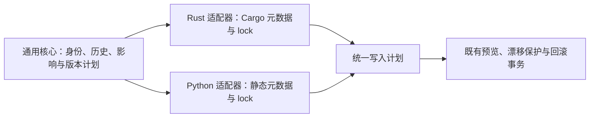

# Rust / Python 通用发布与包生命周期

## 授权与预算

用户确认本对话的通用核心、语言适配器和 lock 计划，并于 2026-10-19 明确授权实施、必要验证及独立审计；禁止提交、推送、发布和真实下游写入。任务规模 L，整体预算 240 分钟、120k 新增 token（估算，含主对话和子 Agent，token 未实测）、最多 4 个子 Agent、最多 2 轮完整验证；预计超额时保存进度并停止超额动作。当前模型无可靠周额度校准，不伪造占比。关联既有 TODO-010，不另建重复事项。

## 合同

1. 保留 schema 1 / 2 行为；schema 3 显式选择通用独立包策略，支持 Rust、Python 及混合仓库。普通同步不升版。
2. 通用核心拥有稳定身份、生命周期、历史归属、影响传播、产品版本、计划和事务；适配器拥有语言元数据、版本、依赖和 lock 语义。全部实现于受管 Rust。
3. 两类语言均覆盖修改、新增、改名、移动、移除、拆分、合并。迁移声明核验实际快照，旧路径事件不丢失；退役身份不复用；拆合至多一条版本继承线。
4. 根 VERSION 保留产品版本事实源；每个包一个原生版本事实源。新增包保留初始版本，纯机械移动不额外升包版；兼容性与升版分开报告。
5. Python 区分 distribution 名、import 名、目录；PEP 440 / 508 规则不套用 Rust 版本类型。动态任意代码、未知版本政策和未知格式必须明确阻断。
6. 结构调整先提供一致的 manifest / lock，发布只执行可证明的最终版本和锁元数据更新；不重新选择第三方版本，不伪造制品 hash。分别声明 Cargo、uv、Poetry、PDM、pylock 的实际支持状态和版本。
7. 预览零写入、无构建、无联网；执行复用现有 drift guard、index/tree guard 和失败恢复。真实下游、用户级安装、发布和业务运行不在本轮范围。

## 传播四问

属于通用产品层，修改 templates/hooks 与共享 Skill 并同步自身 dogfood、受管资产与分发清单；无工厂事实下沉。正式发布时才由受管事务更新 VERSION 及 [product] CHANGELOG，本轮不预写。

## 验证与交付

覆盖两种语言全部生命周期、前后依赖图、跨语言显式关系、迁移链、删除重建、初始包纳入、旧配置兼容、重复发布、输入漂移和失败恢复。语言 / 格式 / 版本能力以实际 fixture 为准。工程检查遵循 development-completion.md：镜像、锁定构建、完整 workspace、factory fixture、七项检查和独立 review-auditor。源码、产品传播、dogfood、fixture、真实下游与 runtime 分别报告。

## 实施结果与支持边界

通用核心、生命周期回放、schema 3 配置与受管 setup、Rust / Python 适配器已经实现；schema 1 / 2 仍走原合同。身份关系由 package_events / lifecycle_events 输出，存续包版本由 package_changes 输出。修改、新增、重命名、移动、移除、拆包、合包分别有两类语言 fixture；另有跨语言 build 依赖、累计历史、连续改名、退役身份、版本源冲突和机械移动反例。



| 能力 | 实际范围 |
|---|---|
| Rust | Cargo 原生元数据、本地依赖与 feature 图、Cargo.lock 3 / 4；历史 schema 1 的有限豁免保持原边界，当前和 schema 2 不放宽 |
| Python 元数据 | 静态 PEP 621、setup.cfg、传统 Poetry，显式外部静态版本源；distribution 为发布身份，import 名不代替身份，源码按路径归属 |
| Python 版本与依赖 | PEP 440 / 508；普通三段版本自动升级，复杂版本需显式目标及影响级别；保留 marker / extras / source |
| lock | uv 1 revision 0–5、Poetry 2.1、PDM legacy 4.5.0 / 4.5.1、pylock 1.0；requirements-export 仅接受可证明的 editable 本地源 |
| 明确阻断 | 任意动态 setup.py / SCM 后端执行、未知 lock、PDM canonical / workspace 摘要、无法证明的本地条件或制品更新；不宣称任意 Python 生态或工具版本均支持 |

真实结构调整必须先提供一致的新 manifest / lock；发布器验证并更新版本，不代替包管理器求解第三方依赖或重建制品。

## 验证记录

| 证据 | 当前结果 |
|---|---|
| 源码与模板 | 已实现并同步 dogfood；全树镜像一致性测试通过 |
| 受管构建 | build-assets 成功；新 CLI self-test 包含通用发布、Python 和生命周期能力 |
| 原生 lock oracle | 4 项通过：uv 0.9.8、Poetry 2.1.4、PDM 2.25.9；包含 uv 条件依赖及空 extra 简化；原生工具接受更新后的 lock 且无需重写 |
| CLI 事务 | 临时仓库 / 本地 bare remote 中通过预览零暂存写入、提交失败回滚、成功后 clean / ahead=0 / behind=0、重复 release 不再次升版 |
| 完整 workspace / 工厂检查 | 最终 workspace 418 passed / 0 failed / 12 ignored；factory 92 passed / 0 failed / 6 ignored；七项受管检查全部通过 |
| 独立审计 | review-auditor 源码、发布说明及测试配置独审 passed，无遗留可执行问题；绑定开发指纹 dc9cb3cf8b59c445d39b0de0409042394d55a36391e9ead3bec198b64f08b710 |
| 产品传播 | templates / 共享 Skill / dogfood / 受管清单已更新；未分发到用户级或真实下游 |
| 真实下游 / runtime | 未验证：本轮没有真实下游写入、真实业务运行或桌面 Hook 生命周期 smoke；pylock 原生消费者也未验证 |

原生 oracle 在隔离测试环境安装工具，不安装业务包、不执行任意业务构建后端。PDM 测试环境固定 hishel 0.0.33，以匹配 PDM 2.25.9 的导入接口。完整测试默认忽略需要外部工具的 oracle，它们已单独显式执行。

## 最终工程收据

实施与工程验证完成，用户验收决定见下节。第 1 轮核心完整集为 377 passed / 1 failed / 10 ignored：合法 PEP 621 + Poetry source 的测试遗漏 `local_sources`，导致 registry 约束按合同保持。仅补齐测试配置，原断言和 registry 反例保留，精准复测 1 passed；独立审计复核后，由正式准备流程执行第 2 轮完整验证，通过上述最终完整集。两套最终完整集共 510 passed / 0 failed / 18 ignored；忽略项不计为通过，其中 4 项原生 oracle 已另行执行，其余为子进程辅助、显式性能 / live / 额外环境或授权入口。

实际检查命令：

```powershell
cargo test --locked --config scripts/tests/factory-cargo.toml --manifest-path .codex/hooks/Cargo.toml --workspace -- --test-threads=1
cargo test --locked --manifest-path scripts/tests/Cargo.toml -- --test-threads=1
# 单独运行 oracle 前设置 BRIDGEFORGE_PYTHON_LOCK_TOOLS 与 BRIDGEFORGE_PDM_LOCK_TOOLS，指向隔离工具环境。
cargo test --locked --config scripts/tests/factory-cargo.toml --manifest-path templates/hooks/Cargo.toml -p bridgeforge-core release::python_native_tests -- --ignored --test-threads=1
.codex/bin/bridgeforge.exe git-sync --prepare-release --message-file .runtime/polyglot-message.txt --audit-file .runtime/polyglot-audit.json
```

| 收据 | 实际结果 |
|---|---|
| 准备记录 | `.runtime/bridgeforge-codex/release-preparation/current.json`，status=prepared，checks_passed=7，checks_executed=7，checks_reused=0 |
| 隔离目标 | 2.6.0；工作区 VERSION 仍为 2.5.2，没有预写 CHANGELOG 或发布 |
| workspace 日志 | `sha256:e8020accb9d588f753a98a0419fd0ea729e4b37db62364eb20a7f3b2448eba5d` |
| factory 日志 | `sha256:cb4790c7449e809948d7db14fb0a77079d3736729da386538ad3e5824127366d` |
| 隔离 CLI 产物 | `sha256:0deda67b1a5e255dabcaf836af56be0c8fbfc21e38ad99a48a85ee0718fb2cbb` |
| 隔离 Hook 产物 | `sha256:582917609808f022074050bc1ce3073c35ffd21018fd887e37644bef3332a4ff` |

日志和隔离产物保存在准备目录的 `blobs/`，不进入 Git。预算启动计时约 105 分钟，使用 4 个子 Agent、2 轮完整验证；新增 token 未实测，不伪造使用量。总结只补充当前记录和索引，不改变 TODO-010 的用户验收状态、AGENTS 或 Memory。

工程准备结束时只读核对在与工程检查相同的授权执行环境中返回 `status=prepared`、`record_documents_changed=true`、`record_documents_check=passed`；说明收据允许补齐记录类文档。普通沙箱读取曾因执行环境不同返回 `development check environment changed`，不能把它解释为源码变化；环境校验未被放宽。该时点 HEAD 为 `6e6c4e38c81cc6331e6071bfbc265eb9ca3c353f`，VERSION 为 2.5.2，VERSION / CHANGELOG 无 diff，`git diff --check` 通过，实际工厂没有新增 `.codex/.bridgeforge_codex_version`。该时点工作区保留本轮改动，未提交。

## 本轮经验

1. 生命周期声明顺序不能代替提交顺序。连续重命名及拆分须按实际快照消费，业务影响只沿其后发生的身份变化传播；已发布退役身份永久保留。
2. lock 里的解析结果不一定逐字保留声明。uv 可省略已证明为空的 extra，只有 requires-dist、实际空 optional-dependencies 和 provides-extras 同时证明时才接受；不能通用忽略 extras 差异。
3. Poetry 的 path / git / url 源表不能同时伪造 version。标准依赖约束与工具源补充分别解析，并用原生工具验证最终结果，避免自制 fixture 互相印证。
4. 机械移动只能排除已知原生依赖路径字段。lib.path 或业务 metadata 的 path 改变属于语义变化，不能递归删除任意 path 后声称等价。
5. Windows 正在运行的 CLI 不能覆盖自身。直接 build-assets 的权限失败已回滚；复制并校验相同哈希的 CLI 到忽略目录，再调用同一受管 build-assets 完成安装，没有手工替换产物或修改 ACL。

工程准备期间未预写根 VERSION / CHANGELOG，未提交、推送、发布或修改真实下游；后续用户决定如下。

## 用户验收与发布授权2026-10-19

用户明确调用 `$summary accept`，确认本次 Rust / Python 通用发布核心、语言适配器及修改、新增、重命名、移动、移除、拆包、合包的历史 / 依赖 / lock 处理符合需求。依据本卡的当前工程收据与独立审计，TODO-010 已完成；保留原编号，并由本节作为正式验收依据。此前同一 TODO 的 Rust 首期及新增包修复记录链接至本节，不把历史测试当作本轮证据。

用户同时明确调用 `$git-sync release`，授权本轮改动通过项目受管入口提交、推送与发布。实际版本、commit、产物复用和同步状态以最终受管收据为准；不以准备目标或验收替代发布结果。真实下游写入、用户级安装、业务兼容与自然 runtime 仍未验证，也未因本次发布授权而获准执行。

本次仅结算 TODO-010；其他 TODO 保持原状，没有新增独立待办。复用本对话已阅读的历史锁合同记忆及现行项目约束，无需新增 Rule / Hook / AGENTS 建议，未写入 Memory。当前 topic 可作为归档候选；如需移动请另行调用 `$archive-scan`，本轮不归档。
